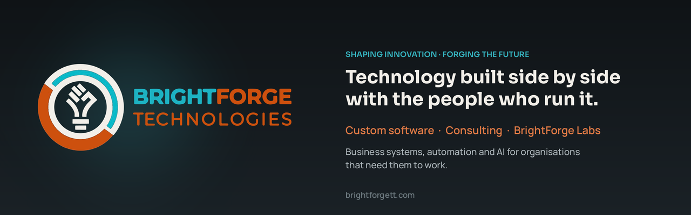

**BrightForge Technologies helps businesses scale and stay secure — through
technology built side by side with the people who run them.**

We do two things, and each makes the other better:

<table>
<tr>
<td width="50%" valign="top">

### 🔧 Custom software & consulting

Systems built around how *your* business actually works — designed with
you, delivered, and looked after for the long run.

- **Business management systems** — point of sale, inventory, invoicing,
  operations and reporting
- **Integrations & automation** — connecting ERP, accounting, learning and
  line-of-business systems so data moves on its own
- **AI for real work** — assistants, document processing and workflow
  automation, including private, on-premises AI
- **Consulting** — technology strategy, security reviews, system rescue and
  modernisation

[Book a conversation →](https://brightforgett.com)

</td>
<td width="50%" valign="top">

### 🧪 BrightForge Labs

Our innovation arm. Labs turns what we learn in the field into products —
built in the open, free to use, and backed by the same team.

- **Open source first** — real, useful software under the AGPL-3.0
- **Hosted & supported** — prefer not to run it yourself? We'll host,
  set up and support it
- **Commercial licences** — for organisations that need other terms
- **Built for small business** — local currencies and taxes,
  WhatsApp-friendly workflows and low-cost hosting are defaults, not
  afterthoughts

[See the projects ↓](#-brightforge-labs-projects)

</td>
</tr>
</table>

## 🧪 BrightForge Labs projects

| | Project | What it is | Status |
|:-:|---|---|---|
| <picture><source media="(prefers-color-scheme: dark)" srcset="assets/exa-logo-dark.png"></picture> | **[Exa the Executive Assistant](https://github.com/brightforge-tech/exa)** | An AI executive assistant that lives on your Android phone — messages, email, calendar, tasks and a daily briefing, with every action approved and logged. Works with cloud, local or on-device AI. |  |
| | **Point of sale & inventory** | Scan-to-invoice counter sales, stock control and customer accounts for small retail and trade counters. Runs on low-cost hosting. |  |
| | **Practice management** | Appointments, patients, billing and receipts for small clinics and medical practices. |  |
| | **Website & shop builder** | A website, online shop and in-store POS in one simple install. |  |

⭐ Star or watch a repo to follow along — and if a project helps you,
[tell us what you'd build next](mailto:info@brightforgett.com?subject=BrightForge%20Labs%20idea).

## How we work

|  |  |
|---|---|
| **Built with you** | We sit inside your business, not outside it. Decisions are made together, at every stage. |
| **Job done, guaranteed** | We define success before we begin. If we can't commit to the outcome, we don't start. |
| **A personal touch** | A named person answers your call. Real engineers, real conversations. |
| **Partner for life** | We stay long after launch — systems maintained, evolved and secured for the life of your business. |

Your security and privacy come first, so we never name our clients.

## Get in touch

🌐 [brightforgett.com](https://brightforgett.com) &nbsp;·&nbsp;
✉️ [info@brightforgett.com](mailto:info@brightforgett.com) &nbsp;·&nbsp;
📞 [+1 (868) 739-1493](tel:+18687391493) &nbsp;·&nbsp;
💬 [WhatsApp](https://wa.me/18687391493)

BrightForge Technologies Limited — <i>Shaping Innovation, Forging the Future.</i>
